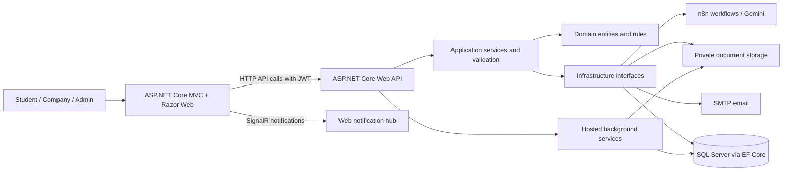

# Interlane System Documentation

**Purpose:** Project handover describing what Interlane is for, how its major workflows are implemented, the technologies used, how the projects fit together, and how to run the system during development.

**Implementation snapshot:** This document describes the source currently in this repository. Feature presence is not the same as complete production acceptance: live integrations, legal/policy decisions, recovery drills, and end-to-end workflow coverage are called out separately.

## 1. What the system is for

Interlane is an internship and early-career marketplace. It connects students with employers and manages the work that happens after a listing is posted. The application covers opportunity discovery, applications, hiring decisions, and internship placement/progress.

### Main user roles

- **Student:** creates an account and career profile, discovers internships, saves opportunities, applies, tracks decisions, uploads documents, and participates in the placement lifecycle.
- **Company:** completes company registration and verification, maintains a company profile, publishes opportunities, reviews applicants, schedules interviews, makes offers, and manages placements.
- **Administrator:** reviews company evidence, moderates content, manages reports and disputes, and uses administrative and audit functions.

The implementation also has role-specific career and company assistants. They provide advice and read-only information through controlled API tools; they do not submit applications, change hiring decisions, publish listings, or send messages on the user's behalf.

## 2. High-level architecture



### Request and responsibility flow

1. The browser sends a request to the Web MVC application.
2. A Web controller/view model calls a typed API client through the `InternshipApi` HTTP client.
3. The API authenticates the JWT and applies role checks, request validation, rate limits, middleware, and controller behavior.
4. Application services enforce use-case rules and access checks through `IApplicationDbContext` and other interfaces.
5. Infrastructure implements persistence, email, document storage, password-breach checks, and n8n communication.
6. The API returns a response; the Web application renders it as a page or updates the relevant user interface.

The Web application and API are separate ASP.NET Core processes. The Web project is an MVC/Razor user interface, not a JavaScript single-page application. It makes server-side API calls and keeps JWT/refresh-token values in session rather than exposing them to browser JavaScript.

## 3. Projects and layers

| Project | Responsibility | Examples |
| --- | --- | --- |
| `InternshipManagement.Domain` | Persistent entities, enums, shared types | `Internship`, `InternshipApplication`, `Placement`, `PrivateDocument`, statuses |
| `InternshipManagement.Application` | Use cases, business logic, DTOs, interfaces, validation | `ApplicationService`, `InternshipLifecycleService`, `PrivateDocumentService`, matching, CV analysis |
| `InternshipManagement.Infrastructure` | External and persistence implementations | `ApplicationDbContext`, EF configurations/migrations, Identity, SMTP, local/Azure storage, ClamAV, n8n clients |
| `InternshipManagement.Api` | HTTP API, authentication, middleware, controllers, hosted jobs, composition root | Auth, applications, company/admin controllers, health endpoints |
| `InternshipManagement.Web` | MVC/Razor pages, session, API clients, hubs, user-facing workflows | Home, account, student, company, admin, resources, saved opportunities |
| `InternshipManagement.UnitTests` | Focused tests for selected business/security paths | JWT config, scanner protocol, document upload persistence |
| `InternshipManagement.IntegrationTests` | Intended home for broader API/workflow tests | Currently no substantive tests |

## 4. Technologies and why they are used

- **C# / .NET 10 / ASP.NET Core:** the runtime, Web MVC application, API, middleware, background workers, dependency injection, and HTTP endpoints.
- **Razor MVC:** server-rendered pages and form workflows in `InternshipManagement.Web`.
- **Entity Framework Core 10 + SQL Server:** relational persistence, query composition, constraints/indexes, and schema migrations.
- **ASP.NET Core Identity:** user records, password hashing, role management, lockout, and token providers.
- **JWT bearer tokens:** authenticate Web-to-API requests. Issuance and validation read the same required signing configuration through `JwtConfiguration`.
- **SignalR:** real-time notification delivery from the Web server to connected browsers.
- **FluentValidation:** request validation registered in the API's dependency injection setup.
- **MailKit / SMTP:** verification, security, and workflow email delivery.
- **n8n + Google Gemini:** selected AI operations such as CV analysis, internship draft assistance, matching explanations, skill-gap guidance, and streamed assistants. n8n credentials are configured outside source control.
- **Azure.Storage.Blobs + Azure.Identity:** optional private object storage using `DefaultAzureCredential`; local disk remains the default.
- **ClamAV INSTREAM protocol:** optional streaming malware scan of uploaded documents without a ClamAV-specific NuGet dependency.
- **xUnit + SQLite test database:** automated checks for selected service behavior, including document upload persistence.

## 5. How the main workflows are implemented

### 5.1 Sign-up, sign-in, and account security

The API's `AuthController` delegates to application authentication services, which use ASP.NET Core Identity and `IdentityService`. Users are assigned Student, Company, or Admin roles. Email verification and password reset use persisted, expiring action-token records. Refresh tokens are rotated and tracked; the Web application's `TokenRefreshCoordinator` coordinates concurrent refresh requests so simultaneous requests do not reuse a one-time token.

JWTs are signed and validated with the same `JwtConfiguration`. The signing key must come from User Secrets or a deployment secret provider, must be at least 32 bytes, and is not given a source-code fallback. Issuer and audience are also required. API middleware applies session controls and restricts unverified accounts. Identity lockout, password requirements, rate limits, and session durations are configuration-backed.

### 5.2 Company onboarding and verification

Companies create a profile and submit verification evidence. The application has review states and history; administrators can review the evidence and approve, reject, request more information, or otherwise manage verification. Internship publication checks the company verification state. Exact evidence standards, review targets, and appeal service levels are business policies and still require stakeholder approval.

### 5.3 Internship creation and discovery

Employers create and manage internship records through API/application services. The data model includes role description, requirements, location, remote/work arrangement, internship type/duration, dates, deadline, positions, compensation, stipend/currency, eligible programmes, moderation state, and publication state. Student-facing pages call API clients to browse, filter, sort, view, save, and apply to opportunities. The SRS review found matching/recommendation services and saved internships in the implementation.

`Internships:RequireSubscription` can gate publishing/drafting paths, but it is `false` in Development. Subscription/payment completeness is not assessed in this overview.

### 5.4 Application, selection, and hiring lifecycle

Applications persist a student profile, internship, status, cover letter/additional-document references, status history, shortlist details, interview schedule, and offer details. The application layer enforces workflow transitions and ownership/role rules. Database indexes protect important invariants such as duplicate student/opportunity applications.

The lifecycle services support interview scheduling and outcomes, offer creation/response, accepted-offer placement creation, placement status/progress, extensions, withdrawals, disputes, completion, and evaluations. Placement creation checks for an existing placement and active conflicting placements; a unique index protects one placement per accepted application. Notifications are sent through in-app and email paths as configured.

### 5.5 Private document upload and access

Student CVs and supporting files, company evidence, and other application documents use a private-document service. Uploads are limited to 10 MB, restricted by extension and category, checked against expected file signatures, and assigned server-generated GUID identifiers. Files are stored outside the public web root. The database stores owner/category/name/content type/length/state/timestamps and access metadata; it does not contain the file bytes.

Downloads use short-lived, hashed access tokens. The API checks document state, requester identity/role, and relevant application, placement, report, or verification context before issuing/opening a link; access events are audited. A company may continue to view an attached CV after an internship closes as long as the application remains available and the document is not marked Deleted. Marking a document Deleted revokes access links.

Storage providers:

- **Local (default):** `App_Data/PrivateDocuments` relative to the API content root. Paths inside the public web root are rejected. Local files are suitable for development; they are not automatically durable across ephemeral hosts or multiple instances.
- **Azure Blob (optional):** selected with `PrivateDocumentStorage:Provider=AzureBlob` and an HTTPS `BlobServiceUri`. The provider creates/checks a private container and uses `DefaultAzureCredential`, which can use developer authentication locally or managed identity in Azure. The repository does not contain storage account keys or create/provision an Azure account. Live Azure operation has not been verified.

Malware scanning is performed before storage when enabled. `ClamAvMalwareScanner` streams the file using the ClamAV INSTREAM protocol. An infected result, timeout, scanner connection failure, or non-clean response rejects the upload. Base settings enable scanning and point to `127.0.0.1:3310`; `appsettings.Development.json` explicitly disables scanning so local development does not require ClamAV. Configure a reachable scanner and enable the setting before using the upload flow in an environment that requires malware protection. No live scanner has been tested.

`DeletedDocumentPurgeService` checks daily for records marked Deleted whose `ClosedAt` is older than `DocumentRetention:AfterDays`. It removes the file, access tokens, and metadata in batches. The setting is `null` by default, so automatic purging is off. A retention period has deliberately not been assumed. Backup and restore of the database plus document storage are not yet automated or restore-tested.

### 5.6 AI-assisted services

The API calls n8n through typed HTTP clients. Non-streaming requests have a timeout; chat can stream responses with a caller-managed timeout. API options require distinct inbound/outbound keys of at least 32 characters. The API exposes narrowly scoped tools/callbacks with run-token or API-key checks. CV text is sanitized to remove contact details and personal identifiers before it is sent for AI analysis. AI suggestions are returned for user review; they do not publish content or make hiring decisions automatically.

Workflow definitions live in `n8n/`. They are not automatically imported, activated, or configured with Gemini credentials by API startup.

### 5.7 Email, notifications, and scheduled jobs

MailKit sends email through the configured SMTP server. In Development, the repository includes an optional smtp4dev compose file. The Web application exposes a SignalR hub for real-time updates; internal API-to-Web push is registered separately. Hosted jobs handle email-verification housekeeping, internship deadlines, AI job processing, recommendations, and—when enabled—document purge. These in-process jobs need further consideration for multi-instance production deployment to avoid duplicate execution.

## 6. Configuration and local development

### Required local configuration

The API project is configured for User Secrets and validates these settings during startup:

| Key | Requirement / purpose |
| --- | --- |
| `JwtSettings:Key` | At least 32 bytes, private secret used to sign and validate JWTs |
| `N8n:OutboundApiKey` | At least 32 characters; API-to-n8n authentication |
| `N8n:InboundApiKey` | At least 32 characters, different from outbound; n8n-to-API callback authentication |
| `Seed:AdminPassword` | Needed only to create the initial admin if it does not exist |

The checked-in configuration also uses SQL Server LocalDB, local SMTP settings, local web/API addresses, and local document storage. Development disables malware scanning explicitly. Set credentials using `dotnet user-secrets set ... --project InternshipManagement.Api`; see the root README for commands.

### Start order

1. Make sure SQL Server LocalDB is installed and available.
2. Configure API User Secrets.
3. Run `dotnet run --project InternshipManagement.Api`.
4. Optionally start smtp4dev with `docker compose -f docker-compose.smtp4dev.yml up -d`.
5. Run `dotnet run --project InternshipManagement.Web` in a second terminal.
6. For AI features, run n8n, import/activate the required workflows, and configure Gemini and matching API keys.

The API currently runs EF Core migrations during startup and seeds Student, Company, and Admin roles. Avoid assuming the development startup migration strategy is the desired production database deployment process without reviewing it first.

### Useful commands

```powershell
dotnet build InternshipManagement.slnx
dotnet test InternshipManagement.UnitTests/InternshipManagement.UnitTests.csproj
dotnet test InternshipManagement.IntegrationTests/InternshipManagement.IntegrationTests.csproj
```

API health endpoints:

- `GET /health/live` — process liveness.
- `GET /health/ready` — database connectivity readiness; returns 503 if the database cannot be reached.

## 7. Security and operational controls present in code

- JWT signing configuration validation and no built-in signing-key fallback.
- ASP.NET Identity password hashing, role checks, lockout, email verification, and refresh-token controls.
- Request rate limits for login, password reset, AI generation, and global API traffic.
- Private document storage, upload size/type/signature checks, authorization checks, short-lived hashed access tokens, and access auditing.
- Configurable ClamAV-compatible malware scanning that fails closed when enabled.
- Configurable document purge worker, disabled until a retention period is selected.
- `/health/live` and database-backed `/health/ready` endpoints.
- The patched `System.Security.Cryptography.Pkcs` 9.x dependency is pinned to version 9.0.21.

These controls do not by themselves establish production readiness. The API build and focused tests have passed during development, but live Azure/scanner tests, broader application workflow tests, backup/restore exercises, load testing, security review, privacy policy review, monitoring, and production deployment validation remain separate work.

## 8. Known implementation boundaries and next work

- **No general legal retention period is encoded.** Document purge applies only after a record is marked Deleted and a positive `DocumentRetention:AfterDays` value is configured. The selection/application lifecycle does not automatically start this countdown.
- **CV access after opportunity closure:** company access is tied to a non-deleted application and active document, not to the internship remaining open. Deleting the source document revokes access.
- **No automated backup/restore:** database and document backup targets, schedule, RPO/RTO, encryption, and restoration procedure still need a decision and a tested implementation.
- **Integration coverage is limited:** the separate IntegrationTests project has no substantive tests. Current tests cover selected JWT and document/scanner cases, not the full registration-to-placement lifecycle.
- **Azure is optional and unverified:** account provisioning, managed identity permissions, networking, deployment settings, and live storage integration remain deployment work.
- **Malware scanner is not bundled:** environments requiring scanning must operate and monitor a ClamAV-compatible service; Development currently disables scanning.
- **In-process state/jobs:** Web sessions use in-memory distributed cache and background jobs run inside the API process. Multi-instance deployments need shared session storage and deliberate job coordination.
- **Policies require approval:** document access matrix, retention schedule, company verification criteria/review targets, privacy/data handling, and audit log retention.
- **Build warnings remain:** restore/build has reported legacy .NET Framework Identity/EntityFramework package compatibility warnings and nullable/analyzer warnings. Dependency and code-quality cleanup remains.
- **Subscription/payment:** subscription gates are configuration-controlled and off in Development; this document does not claim that the subscription/payment product flow is complete.

For the fuller requirement-by-requirement assessment and reviewer comments from the SRS, see [SRS_IMPLEMENTATION_REVIEW.md](SRS_IMPLEMENTATION_REVIEW.md).

## 9. Suggested reading order for a new developer

1. `InternshipManagement.Api/Program.cs` — application composition, middleware, health endpoints, and startup migration/seed flow.
2. `InternshipManagement.Api/Extensions/ServicesCollectionsExtensions.cs` — persistence, Identity, JWT, SMTP, validation, and application-service registration.
3. `InternshipManagement.Application/Interfaces/IApplicationDbContext.cs` — persistence boundary used by application services.
4. The relevant application service, such as `ApplicationService`, `InternshipService`, `InternshipLifecycleService`, or `PrivateDocumentService`.
5. `InternshipManagement.Infrastructure/Persistence/ApplicationDbContext.cs` and `Migrations/` — persistence model and schema evolution.
6. The matching Web controller, API client, and Razor view for the user-facing flow.
7. `InternshipManagement.UnitTests/` and `InternshipManagement.IntegrationTests/` — current automated coverage and its limits.
